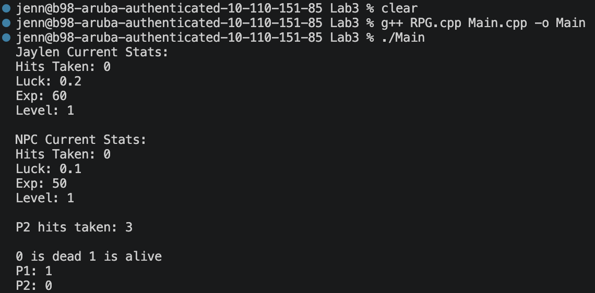

# Role Playing Game Part One

## GitHub Link

https://github.com/Jromero1907/Object-Oriented-Programming/tree/main/Lab3

## Completion Checklist

### RPG Class

- [x] `RPG.h` completed
- [x] `RPG.cpp` completed
- [x] Private member variables implemented
- [x] Default constructor implemented
- [x] Parameterized constructor implemented
- [x] Destructor implemented
- [x] Getter functions implemented
- [x] `setHitsTaken()` implemented
- [x] `isAlive()` implemented

### Testing

- [x] Created and tested multiple `RPG` objects
- [x] Tested the constructors
- [x] Tested the getter functions
- [x] Tested `setHitsTaken()`
- [x] Tested `isAlive()`
- [x] Program compiles without errors
- [x] Program runs correctly

## Program Output

# Role Playing Game Part Two

## Description

This part of the lab expands the original RPG program into a battle royale game. Ten players are randomly selected to fight until only one player remains alive. Players gain experience and increase their level and luck by winning battles.

## Completion Checklist

### RPG Class

- [x] Updated `RPG.h` and `RPG.cpp`
- [x] Implemented `setName()`
- [x] Implemented `updateExpLevel()`
- [x] Implemented `attack()`
- [x] Implemented `printStats()`

### Game Class

- [x] Created `Game.h` and `Game.cpp`
- [x] Implemented `generatePlayers()`
- [x] Implemented `selectPlayer()`
- [x] Implemented `endRound()`
- [x] Implemented `battleRound()`
- [x] Implemented `gameLoop()`
- [x] Implemented `printFinalResults()`

### Testing

- [x] Created 10 RPG players
- [x] Tested random player battles
- [x] Verified players are eliminated after 3 hits
- [x] Verified experience, level, and luck updates
- [x] Verified only one player remains alive
- [x] Program compiles without errors
- [x] Program runs successfully

## Compile and Run

Compile the program:

`g++ Game.cpp RPG.cpp Main.cpp -o main`

Run the program:

`./main`

## Program Output

The program displays the winner of each battle and the final statistics of all 10 players, including their name, hits taken, luck, experience, level, and status.

